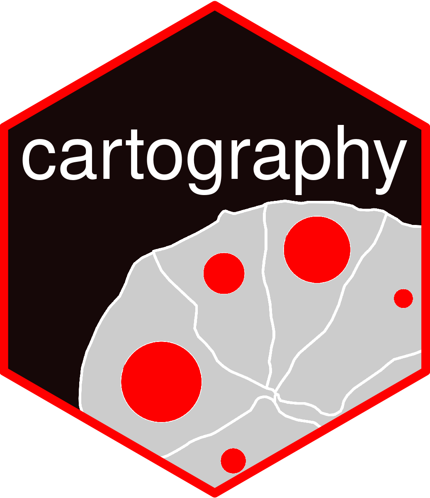

# cartography 

[](https://cran.r-project.org/package=cartography)
[](https://github.com/riatelab/cartography/actions/workflows/R-CMD-check.yaml)
[](https://app.codecov.io/gh/riatelab/cartography)
[](https://doi.org/10.21105/joss.00054)


## Consider [`mapsf`](https://riatelab.github.io/mapsf/)

There are no plans for new features or enhancements in `cartography`.   
Basic maintenance and support will continue indefinitely.   
Existing projects that use `cartography` can safely continue to use `cartography`.   
**The [`mapsf` R package](https://riatelab.github.io/mapsf/) is the successor of `cartography` and it is friendlier, lighter and more robust.**   
See [`mapsf` website](https://riatelab.github.io/mapsf/) to migrate from `cartography` to `mapsf`.


### Thematic maps
This package helps to design cartographic representations such as proportional symbols, choropleth, typology, flows or discontinuities maps. 


### Installation

* Stable version on [CRAN](https://CRAN.R-project.org/package=cartography/)
```r
install.packages("cartography")
```


### Alternatives

* [mapsf](https://github.com/riatelab/mapsf) (successor of `cartography`)
* [tmap](https://github.com/r-tmap/tmap)    
* [ggplot2](https://github.com/tidyverse/ggplot2) + [ggspatial](https://github.com/paleolimbot/ggspatial)     


### Community Guidelines

One can contribute to the package through [pull requests](https://github.com/riatelab/cartography/pulls) and report issues or ask questions [here](https://github.com/riatelab/cartography/issues).


_________

To cite package `cartography` in publications use one of these:  

* [Giraud, T. and Lambert, N. (2016). cartography: Create and Integrate Maps in your R Workflow. JOSS, 1(4). doi: 10.21105/joss.00054.](https://doi.org/10.21105/joss.00054)
* [Giraud, T. and Lambert, N. (2017). “Reproducible Cartography.” In Peterson M. (ed.), _Advances in Cartography and GIScience. ICACI 2017. Lecture Notes in Geoinformation and Cartography._, pp. 173-183. doi: 10.1007/978-3-319-57336-6_13.](https://github.com/riatecom/ReproducibleCartography)  
